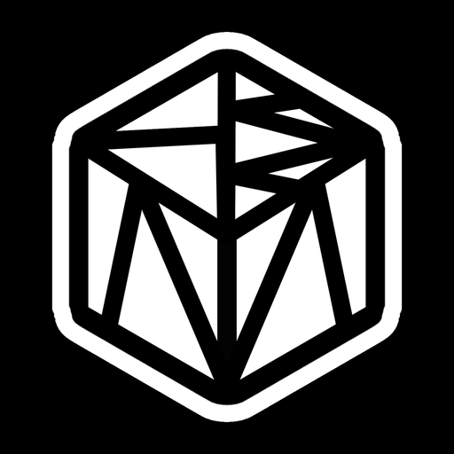

<p align="center"></p>

# True Motion Next

An experimental Android motion graphics editor based on [AbsentMotion 4.3.0](https://github.com/Comett1225/AbsentMotion/tree/v4.3.0), with tools being ported from the earlier True Motion mod.

[Русская инструкция](README_TRUE_MOTION_RU.md) · [Port status](docs/TRUE_MOTION_MIGRATION_RU.md) · [Telegram](https://t.me/TrueMoti0n)

## Included in 0.12.0

- Upstream stable v4.3.0 merged, including its OpenGL backend and new editor tools.
- `.alight` / XML import directly from Projects and `.alight` / `.absproj` package export.
- Full effect color picker, multiple media selection and direct reopening of vector animation layers.
- Native XYZ camera rotation and an optional viewport-only camera frame matte.
- 575 freshly adapted AfterMotionZ+ effects in 11 separate categories, including Deep Glow AE and Saber AE; 575 donor definitions preserved across the update; 210 core/tool definitions. [Scope and validation](docs/AFTERZ_EFFECTS_RU.md).
- Native color grading with wheels, curves and HSL controls.
- Live audio-driven animation referencing an audio layer, beat markers and Bop.
- Native particle simulation, lifetime controls and layer textures.
- Editable nested groups, anchor controls and spatial Bézier motion paths.
- Video frame/composition to image layer, playback up to 100× with audio.
- JavaScript plugin commands, hooks and bundled effects; separate vector animation editor.
- Manual viewport prerender, green timeline cache indicators and a 2 GiB disk cache.
- Animated GIF import and the supplied True Motion launcher/in-app logo.

The port is **not complete**. The remaining donor effects, advanced rigging tools, automatic caching of every viewed frame and the new Windows renderer remain incomplete. Consult the [feature status](docs/TRUE_MOTION_MIGRATION.json) before relying on a feature. Unknown legacy effects are preserved on import, but exact rendering compatibility is not guaranteed.

## Build the compatible Android app

Requirements: JDK 21, Android SDK platform `android-37.0`, build-tools `37.0.0` and the checked-in Gradle wrapper. This compatible build is intended for Android 9+ on ARM64; its declared minSdk follows upstream (26). Older devices have not been tested. Set `ANDROID_HOME` or create your own untracked `local.properties`.

```sh
git clone https://github.com/Mushroom65/TrueMotion.git
cd TrueMotion
./gradlew -PtrueMotionNativePrebuilt=true :app:assembleCompatDebug
```

On Windows use `gradlew.bat`. The result is `app/build/outputs/apk/compat/debug/app-compat-debug.apk`. The package is `app.truemotion`, separate from the earlier APK mod. Locally generated debug signatures differ between machines; they cannot update an APK signed on another machine without its original key. No signing keys are included here.

The fast build uses the included native libraries. The renderer core was rebuilt from the combined C++ source; the other libraries match the official compatible upstream APK. Exact hashes and source provenance are recorded in [TRUE_MOTION_PROVENANCE.json](docs/TRUE_MOTION_PROVENANCE.json). Native changes require rebuilding the core: see [native build notes](docs/NATIVE_AUDIO_BUILD_RU.md) and [upstream build documentation](docs/BUILD.md). For a full native build: `git submodule update --init --recursive`.

GitHub Actions builds the compatible debug APK and runs JVM tests. It does not publish releases or deploy the upstream website. CI-produced debug APKs are development artifacts.

## Artwork and validation

0.12.0: 1,610 JVM tests passed locally (30 environment skips). Android native checks cover all 575 donor effects, the existing tools, editable `.alight` roundtrips and XYZ camera projection in Vulkan/OpenGL. Import/export and the new controls were reviewed through the app UI. [Validation details](docs/RELEASE_0_12_RU.md).

The exact user-provided logo is retained in `branding/true-motion-source.png`. With Pillow installed, run `python tools/icon/package_true_motion.py` to reproduce the app and adaptive/themed launcher assets.

The 0.10.0 compatible build passed [GitHub Actions](https://github.com/Mushroom65/TrueMotion/actions/runs/41078996060): 1,252 JVM tests, 0 failures, 8 skips, plus source/native hash checks. The local APK was installed and its branding checked in MuMu. Native instrumentation with export pixel comparisons belongs to the 0.9.0 feature validation. A physical phone was not tested; see [release validation notes](docs/RELEASE_0_10_RU.md).

The 0.11.0 local validation passed 1,257 JVM tests (0 failures, 12 environment skips), compiled and rendered all 575 new effects on Android, and reran the existing native feature checks. Deep Glow PNG/export matched preview; decoded MP4 mean error was 0.9001/255. Donor-wide visual parity and physical-device validation remain unverified.

## Credits and licences

AbsentMotion authors: source base and renderer, Apache-2.0. Original [LICENSE](LICENSE), [NOTICE](NOTICE) and [THIRD_PARTY_NOTICES.md](THIRD_PARTY_NOTICES.md) are retained. Rhino uses MPL-2.0; its notices are in `app/src/main/assets/true-licenses`. Earlier mod credits remain **Toji Motion / Alight Motion**. The archived upstream README is in [docs/UPSTREAM_README.md](docs/UPSTREAM_README.md).

Effect shaders and available thumbnails were adapted from the user-supplied AfterMotionZ+ Clone APK. Donor provenance, author references and unsupported definitions are recorded in [AFTERZ_EFFECT_PORT.json](docs/AFTERZ_EFFECT_PORT.json) and [port notes](docs/AFTERZ_EFFECTS_RU.md). The donor APK, decryptor DEX and decryptor native library are not distributed here.
